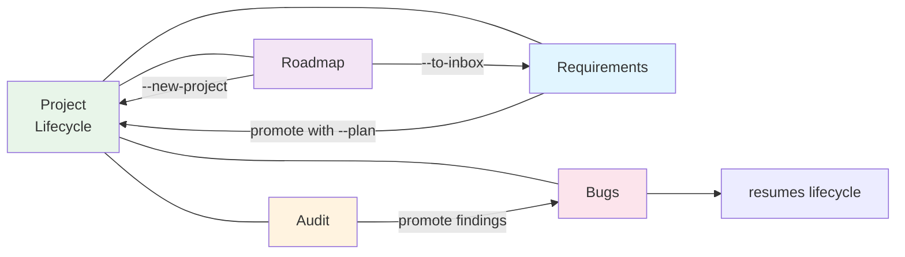

# Flows

A flowchart per major orchestrator loop. Start here when you're trying
to understand "what command do I run next" or "where does this data
go".

All flowcharts are Mermaid blocks — they render natively on GitHub and
in any modern markdown viewer. In a plain-text reader they degrade to
readable indented text.

## 🧭 Lost? Start here

**On Telegram:** send `/coach` (or tap "🧭 What now?" on `/start`). The
bot looks at your project state and tells you literally what to do next,
with tappable buttons.

**On the Mac:** read [`PLAYBOOK.md`](./PLAYBOOK.md) — six concrete
scenario walkthroughs in plain language ("you type X, bot replies Y,
you tap Z"). One read, every common task covered.

The flow docs below are the *reference* — the technical story of what's
happening behind each step. PLAYBOOK is the *how-to*.

## Reading these docs as a website

Three good options for properly-formatted viewing (Mermaid rendered as
diagrams, full-text search, styled typography):

1. **Local doc site (recommended)** — from the orchestrator root:
   ```bash
   npm install        # first time only (installs VitePress dev deps)
   npm run docs       # starts dev server on http://localhost:5173
   ```
   You get a VitePress site with sidebar nav, full-text search,
   light/dark mode, Mermaid diagrams rendered as actual visuals, and
   per-page table of contents. Hot reloads as you edit the .md files.
2. **GitHub** — push the repo, navigate to `docs/PLAYBOOK.md`. GitHub
   renders Mermaid natively. Zero setup, works for anyone who can see
   the repo.
3. **VSCode** — open any `.md`, hit `Cmd+Shift+V`. For Mermaid
   support, install extension `bierner.markdown-mermaid` (one-click
   from the marketplace).

To build a static deploy-ready version of the site (for hosting on a
NAS, Cloudflare Pages, etc.):
```bash
npm run docs:build       # outputs to docs/.vitepress/dist/
npm run docs:preview     # serve the built site to verify
```

## The six core flows

| Flow | When you're using it | Doc |
|---|---|---|
| **Project lifecycle** | Adding a new project, running it end-to-end, shipping | [`FLOW_PROJECT_LIFECYCLE.md`](./FLOW_PROJECT_LIFECYCLE.md) |
| **Requirements** | Capturing thoughts/features, triaging, promoting to a brief | [`FLOW_REQUIREMENTS.md`](./FLOW_REQUIREMENTS.md) |
| **Bugs** | Capturing bugs, promoting to a fix round, running the fixes | [`FLOW_BUGS.md`](./FLOW_BUGS.md) |
| **Audit** | Reviewing a codebase, turning findings into a bug round | [`FLOW_AUDIT.md`](./FLOW_AUDIT.md) |
| **Roadmap** | "What should we build next?" — at project EOL or mid-build | [`FLOW_ROADMAP.md`](./FLOW_ROADMAP.md) |
| **Run / Queue** | Understanding the worker pool, FIFO, notifications | [`FLOW_RUN_QUEUE.md`](./FLOW_RUN_QUEUE.md) |

## How they connect



- **Project lifecycle** is the spine: new project → brief → plan → go →
  ship.
- **Requirements** feeds the brief (front of the pipeline) — captured
  thoughts become `raw-thoughts.md`, which `brief` polishes into
  `brief.md`.
- **Audit** runs against a built project and produces findings, which
  promote into the **bugs** flow.
- **Bugs** can also arrive from manual capture (`/bug`) without an
  audit; the two paths converge at `bug-rounds/round-N/bugs.md`.
- **Roadmap** runs at project EOL and produces suggestions, which
  either spawn new lifecycle runs (via `--new-project`) or feed back
  into the requirements inbox (via `--to-inbox`).
- **Run / Queue** is the underlying machinery — every flow above ends
  up calling `/run` for something.

## Where the data lives

Per-project, the orchestrator maintains a tree under
`projects/&lt;name&gt;/`. The flow docs reference these paths repeatedly:

- `.guide/raw-thoughts.md` — your unstructured inputs (requirements
  flow ends here)
- `.guide/brief.md` — the polished brief
- `.guide/plan.json` — the guide-generated phase plan
- `.guide/phase-N-prompt.md` / `phase-N-report.md` — per-phase artifacts
- `.guide/audits/audit-*.md` — audit outputs (audit flow ends here)
- `bug-rounds/round-N/bugs.md` — input for `bugs` jobs (bugs + audit
  flows converge here)
- `workspace/` — the actual git repo the dev agent edits

SQLite at `state/orchestrator.db` holds:
- `projects` — project rows
- `phases` — phase progression
- `tg_users` — Telegram allowlist
- `tg_jobs` — the job queue
- `requirements` — the inbox (requirements flow)
- `bug_inbox` — the inbox (bugs flow)
- `validator_runs` — validator history
- `calls` — billing/cost telemetry

## Telegram command index

Grouped by flow:

| Flow | Capture | Browse | Triage | Promote / Act |
|---|---|---|---|---|
| Requirements | `/req`, `/capture` | `/inbox` | `/triage` | `/req_promote` |
| Bugs | `/bug`, `/bug_capture` | `/bugs_inbox` | (severity buttons in inbox) | `/bug_promote` |
| Audit | (no inbox — `/run audit` produces it) | `/preview audit` | (manual review) | `/promote` (v0.14.18+) |
| Project | `/new_project` | `/projects`, `/project` | — | `/run &lt;action&gt;` |
| Run | — | `/status`, `/queue` | — | `/cancel`, `/dequeue` |

For the full Telegram command reference (every command, every alias,
every flag), see [`TELEGRAM_BOT.md`](./TELEGRAM_BOT.md).

For the CLI equivalents of every Telegram command, see the per-flow
docs — each has a "Telegram ↔ CLI" table.
