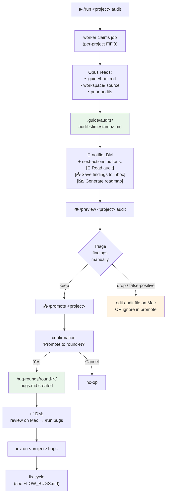

# Flow: Audit

How the orchestrator reviews its own (or any project's) code, surfaces
findings, and turns those findings into a fixable bug round.

`/run &lt;project&gt; audit` is read-only — Claude reads the workspace, never
edits it. The output is a markdown audit document with findings ranked
CRITICAL / MAJOR / MINOR / NIT. A trailing "Promote to bugs-round-N"
section uses a known regex format so the next step can extract structured
fixes automatically.

## Diagram

## Step-by-step

**1. Kick off.** `/run &lt;project&gt; audit` queues an `audit` job. With the
worker pool, this starts immediately if no other job is running on this
project (cross-project concurrency is fine; per-project FIFO).

**2. Generation.** The audit job runs the guide agent with the
`audit-template.md` system prompt addition. It reads `brief.md`, prior
audits (for incremental coverage), and the workspace tree. It writes
`.guide/audits/audit-&lt;timestamp&gt;.md` with findings ranked by severity.

**3. Notification.** On completion the notifier DMs you `✓ Completed:
audit &lt;project&gt;` followed by `next-actions` inline buttons. The actions
are state-aware: after an audit they typically include "Read audit"
(`/preview`), "Save findings to inbox" (manual route via `/bug` /
`/bugs_inbox`), and "Generate roadmap" (`/run roadmap`).

**4. Review.** `/preview &lt;project&gt; audit` streams the audit into your
Telegram chat (paginated). Skim for false positives — audits average
20-30% false-positive rate. Severity-CRITICAL findings deserve a more
careful read.

**5. Promote.** `/promote &lt;project&gt;` (v0.14.18+) reads the most recent
audit, extracts the trailing `Promote to bugs-round-N` section, and shows
a confirmation message with:
- the source audit filename,
- the target round number (auto-selected as next available),
- any warning from the extractor (e.g. "audit drifted from template
  structure").

Tap "Yes" and it writes `bug-rounds/round-N/bugs.md`. Tap "Cancel" to
abort with no side effects.

**6. Manual review.** Before running the fix round, **open the bugs.md
file on the Mac and edit it**. Strip false positives, sharpen severity
assignments, add manual bugs the audit missed. The 10-15 minutes you
spend here saves wasted fix-cycle budget on bogus "fixes".

**7. Execute.** `/run &lt;project&gt; bugs` starts the bug round — see
[`FLOW_BUGS.md`](./FLOW_BUGS.md) from step 4 onwards.

## Telegram ↔ CLI commands

| Step | Telegram | CLI |
|---|---|---|
| Run audit | `/run &lt;project&gt; audit` | `npm run audit -- &lt;project&gt;` |
| Read audit in chat | `/preview &lt;project&gt; audit` | `cat projects/&lt;project&gt;/.guide/audits/audit-*.md \| less` |
| Promote audit → bug round | `/promote &lt;project&gt;` (confirm button) | `npm run promote -- &lt;project&gt; --from-audit` |
| Append to existing round | (not in TG; CLI flag-only) | `npm run promote -- &lt;project&gt; --from-audit --append` |
| Pick specific round | (not in TG; auto = next available) | `npm run promote -- &lt;project&gt; --from-audit --round 5` |
| Run the fix round | `/run &lt;project&gt; bugs` | `npm run bugs -- &lt;project&gt;` |

## What an audit brief should look like

The quality of the audit depends entirely on the brief. A vague "audit
the codebase" yields slop. A focused brief — naming specific files,
concurrency primitives, schemas, claims-to-verify — yields findings you
can actually act on.

The v0.14.18 patch includes a worked example in `docs/AUDIT_BRIEF_ROADMAP.md`
(if you wrote one for the orchestrator self-audit). General rule: list
the specific code paths to walk and the specific invariants to check,
not "be thorough."

## Edge cases worth knowing

- **No audit file found.** `/promote &lt;project&gt;` errors clean with "Run
  /run &lt;project&gt; audit first." It does not auto-trigger an audit.
- **Promote section missing from audit.** The audit-template should
  always produce a `## Promote to bugs-round-N` block; if it doesn't,
  the extractor surfaces the reason and tells you to copy findings
  manually. This usually means the model drifted from the template
  prompt — check `prompts/templates/audit-template.md`.
- **Round-N/bugs.md already exists.** The Telegram path refuses to
  overwrite. On the Mac, use `npm run promote -- &lt;project&gt; --from-audit
  --append` to add to the existing file, or `--round &lt;n&gt;` to choose a
  different round.
- **Audit + bug-inbox both contribute to a round?** Not directly. The
  audit path creates `bugs.md` from audit findings. The inbox path
  creates `bugs.md` from inbox items. If you want both, run the audit
  path first, then **manually edit** the resulting `bugs.md` to add
  hand-noted items before running `/run bugs`.
