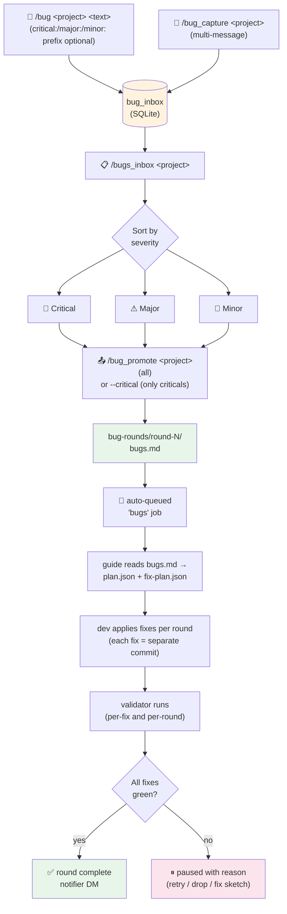

# Flow: Bugs

How a bug report becomes a tracked, planned, fixed-and-shipped bug round.

The bugs inbox is the requirements inbox's twin — same shape, separate
table, parallel pipeline. A bug captured in Telegram ends up as a
file-system bugs round under `bug-rounds/round-N/bugs.md`, which becomes
the input to a `bugs` job that produces a fix plan and patches.

## Diagram

## Step-by-step

**1. Capture.** `/bug &lt;project&gt; &lt;text&gt;` saves a bug. Prefix the text with
`critical:`, `major:`, or `minor:` (e.g. `critical: login redirects loop`)
to set severity inline; the parser strips the prefix from the stored
body. Without a prefix, severity is `unassigned`. `/bug_capture &lt;project&gt;`
enters multi-message mode (mirrors `/capture` for requirements).

**2. Browse.** `/bugs_inbox &lt;project&gt;` shows pending bugs sorted by
severity (critical → major → minor → unassigned), each with the buttons
needed to bump severity, drop, or promote individually. The header shows
the count, e.g. "3 critical, 7 major, 4 minor — 14 pending".

**3. Promote.** `/bug_promote &lt;project&gt;` is the workhorse:
- **Default:** promotes ALL pending bugs into a new round under
  `bug-rounds/round-N/bugs.md` AND auto-queues a `bugs` job to start
  fixing them.
- **`--critical`** flag: only promote criticals; majors and minors stay
  in the inbox.

The `bugs.md` is structured per the v0.12 schema with `## BUG-N` blocks,
severity tags, and an "Expected / Actual / Fix sketch" template.

**4. Fix round execution.** The `bugs` job is the same auto-run primitive
as `go`, but driven by `bugs.md` instead of `brief.md`. The guide agent
reads the bugs file, produces `fix-plan.json` (one fix per bug, with
ordering for dependencies), and the dev agent applies them one at a time.
Each fix is its own commit on `develop`.

**5. Validation.** Per-fix validators run after each individual fix; the
per-round validator suite runs at the end. Failures pause the round with
a `paused: validator-failed:&lt;name&gt;` reason, and the operator decides
whether to retry, drop the bug, or hand-edit the workspace.

## Telegram ↔ CLI commands

| Step | Telegram | CLI |
|---|---|---|
| Capture one bug | `/bug &lt;project&gt; &lt;text&gt;` | `npm run bug -- add &lt;project&gt; "text"` |
| Multi-message capture | `/bug_capture &lt;project&gt;` … `/bug_done` | (TG-only) |
| Browse inbox | `/bugs_inbox [&lt;project&gt;]` | `npm run bug -- list &lt;project&gt;` |
| Promote all + start fixing | `/bug_promote &lt;project&gt;` | `npm run bug -- promote &lt;project&gt; --run` |
| Promote criticals only | `/bug_promote &lt;project&gt; --critical` | `npm run bug -- promote &lt;project&gt; --severity critical --run` |
| AI refine inbox | (no TG handler) | `npm run bug -- refine &lt;project&gt;` |

## The audit→bugs adjacent flow

Bugs can also enter a round without ever touching the inbox — they come
directly from an audit. See [`FLOW_AUDIT.md`](./FLOW_AUDIT.md). The two
paths converge at `bug-rounds/round-N/bugs.md`: from there onwards the
flow is identical.

## Edge cases worth knowing

- **Promoting while a round is already in progress.** The promote target
  is always "next round number". If round 4 is currently running, a
  promote creates round 5; the orchestrator queues the round-5 bugs job
  behind round 4 on the same project (per-project FIFO).
- **Telegram severity prefix vs CLI flag.** `critical: foo` in Telegram
  text and `--severity critical` on the CLI both produce the same stored
  state. Pick whichever's faster on your input surface.
- **Soft cancel mid-round.** `/cancel` during a `bugs` job marks the row
  cancelled and (since v0.6) sends a kill signal to the active claude
  subprocess. Already-committed fixes stay; in-flight ones may have
  partially landed — `git status` will show the workspace state.
- **No pending bugs.** `/bug_promote` on an empty inbox tells you to add
  some first; it does NOT create an empty round.
