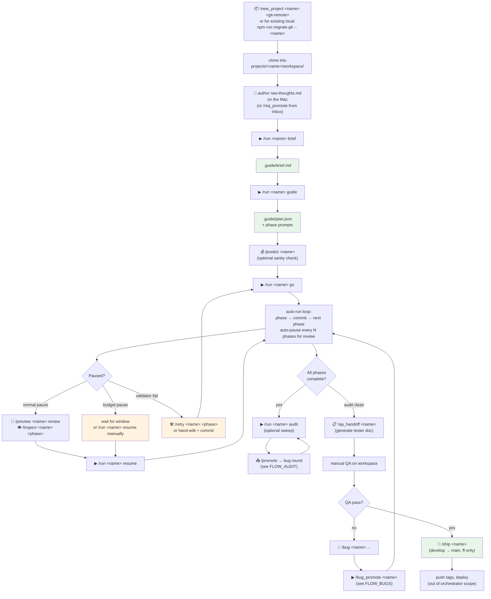

# Flow: Project Lifecycle

The full arc of a project: from `git clone` to a shipped commit on `main`.

This is the orchestrator's "happy path" — the sequence you go through when
adding a new codebase, generating its brief, executing the auto-run, and
landing the result on `main`. Audit and bug rounds are interleaved
sub-flows; see [`FLOW_AUDIT.md`](./FLOW_AUDIT.md) and
[`FLOW_BUGS.md`](./FLOW_BUGS.md).

## Diagram



## The eight named actions

The `/run &lt;project&gt; &lt;action&gt;` verb is the unified entry point. Twelve
actions are valid (see `VALID_ACTIONS` in
`src/server/telegram-handlers.js`):

| Action | What it does | When to use |
|---|---|---|
| `brief` | Generate `.guide/brief.md` from `raw-thoughts.md` | Once per project, or to refresh |
| `guide` | Generate `plan.json` + phase prompts | After brief is approved |
| `go` | Start auto-run from current phase | Main workhorse |
| `next` | Run only the next pending phase | Surgical step-through |
| `review` | Force a guide review at current phase | When you want explicit checkpoint |
| `handoff` | Generate handoff document | For human takeover or pairing |
| `resume` | Resume a paused auto-run | After budget/review/validator pause |
| `audit` | Read-only review of workspace + brief | Anytime, especially before ship |
| `bugs` | Run fixes from `bug-rounds/round-N/bugs.md` | After audit promote or bug-promote |
| `roadmap` | Suggest next implementations after current project | At project completion |
| `qa` | Mark project ready-for-qa or shipped | Lifecycle marker |
| `ship` | Fast-forward `main` to `develop` | Final step (with confirmation) |

## Step-by-step

**1. Register.** `/new_project &lt;name&gt; &lt;git-remote&gt;` clones the remote
into `projects/&lt;name&gt;/workspace/` and creates the SQLite project row.
For an existing local checkout (e.g. you cloned manually), use
`npm run migrate-git -- &lt;name&gt;` to bring it under orchestrator git
management.

**2. Author the brief.** Drop your unstructured thoughts into
`.guide/raw-thoughts.md` on the Mac, OR pump them through the inbox via
`/req` + `/req_promote --plan` (see [`FLOW_REQUIREMENTS.md`](./FLOW_REQUIREMENTS.md)).

**3. Generate brief + plan.** `/run &lt;name&gt; brief` polishes
`raw-thoughts.md` into `brief.md`. `/run &lt;name&gt; guide` reads `brief.md`
and produces `plan.json` plus per-phase prompts.

**4. Sanity-check cost.** Optional but recommended: `/predict &lt;name&gt;`
shows expected per-phase cost based on historical averages for similar
projects. If the predicted total is far over your project budget, refine
the brief before executing.

**5. Execute.** `/run &lt;name&gt; go` is the auto-runner. It executes phases
in order, commits each phase's work separately, runs validators after
each phase, and auto-pauses at design checkpoints:
- After phase 1 (foundation check)
- After every N phases (configurable, default 2) for review
- After validator failures
- When 5-hour window budget gets tight

Each pause sends a `⏸ Paused: ...` DM with next-actions buttons (Resume /
Cancel / etc.).

**6. Review at each pause.** `/preview &lt;name&gt; review` shows the guide's
review document. `/inspect &lt;name&gt; &lt;phase&gt;` shows the phase report and
offers diffstat / full-diff-as-file buttons.

**7. Recovery loops.** If a phase produced something bad,
`/retry &lt;name&gt; &lt;phase&gt;` resets the phase to pending and reverts the
workspace to the parent commit. Confirmation required.

**8. Final audit (recommended).** Before shipping, `/run &lt;name&gt; audit`
to catch issues the per-phase reviews missed. `/promote &lt;name&gt;` →
review the bugs.md → `/run &lt;name&gt; bugs` to fix.

**9. QA handoff.** `/qa_handoff &lt;name&gt;` generates a tester-facing
markdown listing every commit, every behaviour change, and a suggested
test plan. DM'd to you as a file.

**10. Ship.** `/ship &lt;name&gt;` fast-forwards `main` to `develop`. Refuses
non-FF (no force-push). Optional `--tag vX.Y.Z` to tag at the same time.
Confirmation required.

## Project-level files that drive the flow

```
projects/<name>/
├── .guide/
│   ├── raw-thoughts.md         ← you author this (or req_promote does)
│   ├── brief.md                ← generated by `brief`
│   ├── plan.json               ← generated by `guide`
│   ├── plan.md                 ← human-readable form
│   ├── phase-N-prompt.md       ← generated by guide
│   ├── phase-N-report.md       ← generated by dev after phase N
│   ├── review-after-N.md       ← generated at review checkpoints
│   ├── audits/audit-*.md       ← generated by `audit`
│   ├── handoff.md              ← generated by `handoff`
│   └── session-id.txt          ← guide session continuity
├── workspace/                  ← git repo; dev agent edits here
└── bug-rounds/
    ├── round-1/bugs.md         ← input for first `bugs` job
    ├── round-1/fix-plan.json
    └── round-2/...
```

## Edge cases worth knowing

- **Auto-pauses at every phase initially.** First-time runs pause after
  phase 1 by design — gives you a chance to course-correct early. After
  that the configured cadence kicks in.
- **`go` is resumable.** If interrupted (Ctrl-C, server crash,
  `/cancel`), the next `/run go` picks up at the next pending phase.
  The orchestrator tracks `current_phase` in SQLite.
- **The `qa` action.** Marks the project's status enum. It does NOT run
  tests; it's a lifecycle marker. The validator system (`/validate`,
  `/validators`) is what actually runs tests.
- **`/ship` is not a release process.** It just fast-forwards `main`.
  Tagging, releasing, deploying — out of scope, handled by your normal
  release tooling reading from `main`.
