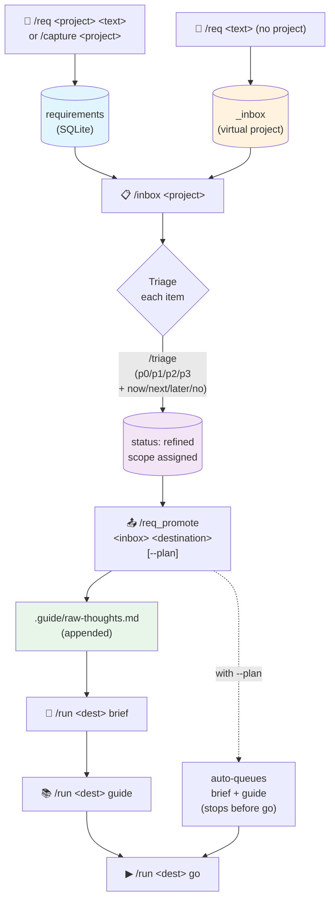

# Flow: Requirements

How an idea or feature request becomes a planned, scoped piece of work in a
project's brief.

The requirements inbox is the orchestrator's "anywhere you want to think
out loud" surface. Captured items live in SQLite, get triaged for priority
and scope, then get promoted into the project's `raw-thoughts.md` so the
guide agent can turn them into a brief on the next run.

## Diagram

## Step-by-step

**1. Capture.** `/req &lt;project&gt; &lt;text&gt;` adds one item to that project's
inbox. `/capture &lt;project&gt;` enters multi-message mode — every non-slash
message becomes an inbox item until `/done`. `/req` without a project arg
falls through to the `_inbox` virtual project, useful when you don't yet
know which project a thought belongs to.

**2. Browse.** `/inbox &lt;project&gt;` (or `/inbox` with a pin) opens an inline
keyboard pager. Each item shows priority, scope, age, and a "📋 Promote
all (N) →" button when at least one item has `scope=now`.

**3. Triage.** `/triage &lt;project&gt;` opens single-item-at-a-time triage with
inline keyboards: p0/p1/p2/p3 priority, now/next/later/no scope, plus
skip/drop/done. Auto-advances to the next pending item after each tap. The
goal is to flip items from `pending` → `refined` and set scope.

**4. Promote.** `/req_promote &lt;inbox&gt; &lt;destination&gt;` is the batch fast lane.
By default it flips any unassigned items to `scope=now`, then appends all
`scope=now` items into the destination project's `.guide/raw-thoughts.md`.
With `--plan` it additionally queues `brief` + `guide` jobs but stops
before `go` — so you review the plan before any code gets written.

**5. Plan + execute.** Once items are in `raw-thoughts.md`, the guide agent
can turn them into a real brief. `/run &lt;project&gt; brief` produces
`.guide/brief.md`, then `/run &lt;project&gt; guide` turns the brief into
`plan.json`, then `/run &lt;project&gt; go` starts the auto-run through the
phases. (Or skip the manual steps with `--plan` on promote.)

## Telegram ↔ CLI commands

| Step | Telegram | CLI |
|---|---|---|
| Add one item | `/req &lt;project&gt; &lt;text&gt;` | `npm run req -- add &lt;project&gt; "text"` |
| Multi-message capture | `/capture &lt;project&gt;` … `/done` | (no equivalent — TG-only) |
| Browse inbox | `/inbox [&lt;project&gt;]` | `npm run req -- list &lt;project&gt;` |
| Triage interactively | `/triage &lt;project&gt;` | `npm run triage -- &lt;project&gt;` |
| Batch promote | `/req_promote &lt;inbox&gt; &lt;dest&gt;` | `npm run req -- promote &lt;project&gt; --destination &lt;dest&gt;` |
| Promote + auto-plan | `/req_promote &lt;inbox&gt; &lt;dest&gt; --plan` | (TG-only — `--plan` queues jobs) |
| Refine with AI | (no TG handler) | `npm run req -- refine &lt;project&gt;` |
| See stats | `/inbox` (header line) | `npm run req -- stats &lt;project&gt;` |

## Edge cases worth knowing

- **No project pinned, no project arg.** `/req some text` lands in
  `_inbox` rather than rejecting. `_inbox` is a virtual project — items
  there have no destination yet. Use `/req_promote _inbox &lt;real-project&gt;`
  to route them later.
- **Items added during a running job.** Safe. The inbox is decoupled from
  the worker pool. Items captured while `/run go` is running don't affect
  the run; they wait in the inbox until you promote them.
- **`/req_promote` with no `scope=now` items.** By design, the v0.14.11
  fast lane flips unassigned items to `scope=now` automatically before
  promotion. If you want strict promote-only-what-I-triaged behaviour,
  triage explicitly first and only `now`-marked items get promoted.
- **Destination memory.** v0.14.11 remembers the last `&lt;destination&gt;` you
  used per inbox-project. Subsequent `/req_promote &lt;inbox&gt;` calls (no
  destination) default to the remembered one.
