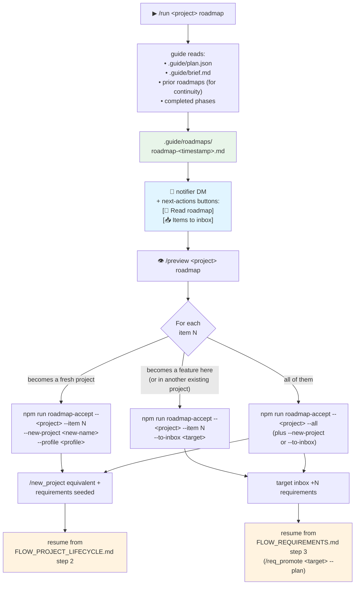

# Flow: Roadmap

How a completed (or substantially-built) project becomes the *next*
project — or several next features in the same project.

The roadmap action analyses what's been built and suggests follow-on
work: usually 3–7 features or new projects, each scoped roughly (tech,
size, dependencies, "why now"). It's never code-writing — it produces a
markdown document that you act on by either spawning new projects or
appending requirements to existing ones.

## Diagram



## When you'd run this

- **End of a project's MVP.** Phases all complete, audit + ship done.
  Run roadmap to plan v2.
- **Mid-project, you want a second opinion.** Roadmap on a half-built
  project compares what's been done against the brief and suggests
  things the brief should have included.
- **You inherit a codebase.** Build + audit it first, then run roadmap
  to get a model's opinion on where to take it next.

## Step-by-step

**1. Pre-requisite check.** The roadmap action needs `plan.json` to
exist — it extrapolates from what's been planned and built. If no plan
exists yet, run `/run &lt;project&gt; guide` first (or skip the roadmap and
write a brief from scratch).

**2. Generate.** `/run &lt;project&gt; roadmap` queues a guide job. Takes 2–5
minutes. The guide agent runs with the `roadmap-template.md` system
prompt addition. Writes
`.guide/roadmaps/roadmap-&lt;timestamp&gt;.md`.

**3. Notification.** Standard completion DM with next-actions buttons
(`📖 Read roadmap`, etc.).

**4. Read.** `/preview &lt;project&gt; roadmap` streams the document into
Telegram. A typical item looks like:

```markdown
## 1. notifications-v2

- **Tech:** Node.js worker + Redis stream
- **Scope:** ~4 phases, ~2 days of work
- **Why now:** current sync pipeline can't survive 10x volume
- **Depends on:** nothing
- **Risk:** medium — Redis Cluster mode is new for us
```

The numbered heading is what the parser keys on. Common formats it
accepts: `## 1. Title`, `## Item 1: Title`, `## Suggestion 1`.

**5. Pick an acceptance mode.** Two choices, mutually exclusive:

- **Spawn a fresh project** (`--new-project &lt;name&gt;`): the orchestrator
  initialises a new project with the selected items as starter
  `raw-thoughts.md` content. Use this when the suggestion is "build a
  whole new thing."
- **Append to inbox** (`--to-inbox &lt;target&gt;`): each selected item
  becomes a requirement row in the target project's inbox. Use this
  when the suggestion is "add this feature to project X."

Both modes accept a single item (`--item 3`), a range (`--items
"1,3-5,7"`), or everything (`--all`).

**6. Continue.** Whichever mode you pick, you're now back in an earlier
flow — either project-lifecycle (new project) or requirements (inbox
items waiting to be promoted).

## Telegram ↔ CLI commands

| Step | Telegram | CLI |
|---|---|---|
| Generate roadmap | `/run &lt;project&gt; roadmap` | `npm run roadmap -- &lt;project&gt;` |
| Read roadmap in chat | `/preview &lt;project&gt; roadmap` | `cat projects/&lt;project&gt;/.guide/roadmaps/roadmap-*.md` |
| Spawn new project from item N | (not in TG — typing git URLs on mobile is painful) | `npm run roadmap-accept -- &lt;project&gt; --item N --new-project &lt;new&gt;` |
| Append item N to existing inbox | (not in TG yet) | `npm run roadmap-accept -- &lt;project&gt; --item N --to-inbox &lt;target&gt;` |
| Append all items to inbox | (not in TG) | `npm run roadmap-accept -- &lt;project&gt; --all --to-inbox &lt;target&gt;` |

The acceptance step is CLI-only because:

- `--new-project` needs a git URL, a project name, optionally a profile —
  too many free-text inputs for a good mobile UX.
- `--items "1,3-5,7"` is range syntax — easier to type on a keyboard.

The Telegram path stops at "read the roadmap." If you want to act on
items from your phone, the practical workflow is to skim the roadmap in
`/preview`, then hand-capture items as requirements:

```
You: /req myproject "Build notifications-v2 worker (per roadmap item 1)"
You: /req_promote myproject --plan
```

This is a more flexible path anyway — you can rewrite the item's
description while capturing.

## Edge cases worth knowing

- **No `plan.json` in the project.** Roadmap can't generate from
  nothing. Errors with "Roadmap needs a project with completed work
  to extrapolate from." Run `/run &lt;project&gt; guide` first.
- **Roadmap items not parseable.** If the model drifted from the
  template heading format, `roadmap-accept --all` and `--items` will
  refuse with a parser error telling you to either edit the roadmap or
  use `--item &lt;n&gt; --new-project &lt;name&gt;` which embeds the entire
  roadmap content as a single new-project seed.
- **Spawning multiple projects from one roadmap.** Run `roadmap-accept`
  once per project — each `--new-project` call creates exactly one
  project. To turn five items into five separate projects, run the
  command five times (or write a shell loop).
- **Prior roadmaps are kept.** Each roadmap run writes a new
  timestamped file under `.guide/roadmaps/`. The guide agent reads
  prior ones for continuity (so you don't get the same suggestions on
  every run). Don't delete them — they're cheap to keep and useful
  context.
- **The `--to-inbox _inbox` shortcut.** If you don't know which project
  an item belongs to yet, send it to the `_inbox` virtual project.
  Later, `/req_promote _inbox &lt;real-project&gt;` routes it.
