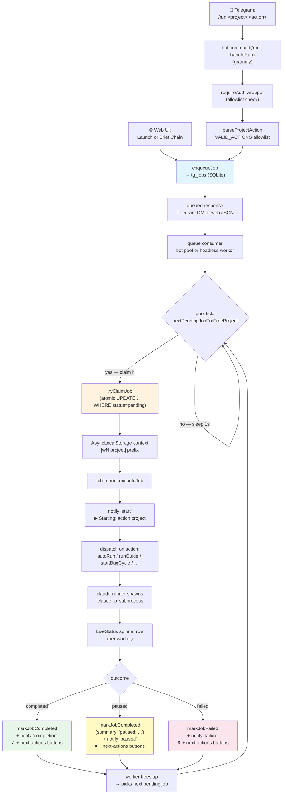

# Flow: Run + Queue

What actually happens between submitting `/run billflow-tds go` or clicking a
web Launch/Brief Chain action and durable execution of that job.

This is the orchestrator's plumbing. Most operators never need to think
about it, but understanding the worker pool + FIFO behaviour helps when
you're running multiple projects concurrently and one of them seems
stuck.

## Diagram

## Step-by-step

**1. Command arrives.** grammy's `bot.command('run', handleRun)` matches
`/run`; `handleRun` is `requireAuth`-wrapped, so the allowlist is checked first.
The web UI's Launch and Brief Chain routes use the same queue directly and
deduplicate an already-pending/running action for that project.

**2. Parse + validate.** `parseProjectAction` splits `&lt;project&gt; &lt;action&gt;`
and checks the action is in `VALID_ACTIONS`. Unknown action → error
message. With v0.14.18's `showRunPicker`, missing args open a button
picker instead.

**3. Enqueue.** `enqueueJob({ project, action, args, requestedBy })`
inserts a row into `tg_jobs` with status `pending`. The reply uses
`formatEnqueueReply` which adds FIFO context — "Starts immediately on a
free worker" or "Waiting behind: [running-job-on-same-project]".

**4. Pool tick.** A bot worker or `src/worker.js` spins on
`nextPendingJobForFreeProject()` — atomically claims the
oldest `pending` job whose project doesn't already have a running job.
That's the per-project FIFO guarantee: at most one job per project runs
at a time, but different projects run concurrently. The claim records the
server PID and a five-minute lease, renewed every 30 seconds.

**5. Worker topology.** Bot servers keep their auto-scaled in-process pool:
each registered project gets a worker up to `max_workers_cap` (default 8).
Production NAS additionally runs one bot-independent headless consumer under
PM2. Atomic SQLite claims allow these consumers to coexist without running the
same job twice. The headless process needs no Telegram/Discord credential and
keeps web-enqueued work moving when no bot is configured.

**6. Context binding.** Inside the worker, `AsyncLocalStorage` binds
`{ workerId, project }` so every `console.log` inside the worker is
prefixed `[w2 billflow-tds]` automatically. Same context drives the
LiveStatus spinner row.

**7. Dispatch.** `job-runner.executeJob` switches on `action`:
- `go` / `resume` → `autoRun(...)` from `auto-runner.js`
- `brief-chain` → restart-safe `runDurableBriefChain(...)`
- `audit` / `brief` / `guide` / `next` / `review` / `handoff` / `qa` →
  `runGuide(...)` from `phase-runner.js`
- `bugs` → `startBugCycle(...)` from `bug-cycle.js`
- `ship` → `shipProject(...)` from `commands/ship.js`

**8. Subprocess.** `claude-runner.js` first checks the shared provider circuit
breaker, then acquires the account-wide FIFO heavy-call lease. By default only
one expensive Claude call can run across all projects/processes; bounded cheap
helpers may bypass it. Bypass only affects concurrency: every subprocess
attempt is still retained as a raw call, and the shared rolling-window meter
charges a default `0.25` heavy-equivalent unit for configured cheap helpers
versus `1` for heavy/unknown tasks. It then spawns `claude -p ...` with the
right `--append-system-prompt`, `--cwd`, and `--resume &lt;session-id&gt;`. The
subprocess runs in the foreground of the worker; stdout/stderr are
captured to `logs/&lt;job-id&gt;/`.

**9. Outcome + notification.** When the subprocess exits, the worker
classifies as completed / paused / failed and calls `notifier.notify(...)`.
The notify payload includes a `replyMarkup` (inline keyboard) built from
`next-actions.js` for that action's "what next" suggestions. Bot workers send
that notification to the configured platform; the headless worker logs it and
the web UI reads the same persisted job/project state.

**10. Frees up.** The worker loop returns to step 4 and picks the next
pending job on a free project.

## Concurrency invariants

| Invariant | Enforced by |
|---|---|
| At most one job per project running | `nextPendingJobForFreeProject` — atomic SELECT … WHERE NOT EXISTS (running for same project) |
| Pending jobs claimed atomically | `tryClaimJob` — UPDATE … WHERE id=? AND status='pending' (returns rowcount) |
| FIFO order per project | `nextPendingJobForFreeProject` ORDER BY id ASC |
| Cross-project job concurrency | Multiple consumers may claim different projects |
| Expensive provider concurrency | `provider_call_leases` FIFO; default `max_concurrent:1` across every process/project |
| Bot worker count ≤ projects (capped) | Bot pool auto-scales up to `max_workers_cap`; NAS headless worker is a separate PM2 app |
| Notifier failures don't strand jobs | `notifySafe` wraps each notify in its own try/catch (v0.14.0 BUG-3) |
| Server crash doesn't strand replay-safe work | `reconcileStaleRunningJobs` requeues expired/dead-owner leases on startup; `go`/`next` become `resume` |
| One durable resume per project | `enqueueUniqueResumeJob` transaction covers pending + running rows |
| Picker failure doesn't kill a worker | worker loop catches, backs off 2 seconds, and continues |
| Provider exhaustion doesn't cascade calls | shared circuit breaker rejects admission before spawn until reset |
| Cheap helper attempts remain accounted | `windowStatus` weights `heavy_call_lease.cheap_tasks` by `cheap_call_weight`, preserves raw attempts separately |

## Telegram surfaces during a run

| Event | DM you get |
|---|---|
| `enqueueJob` | `▶ Queued #42: audit billflow-tds` + FIFO context |
| Pool claims it | `▶ Starting: audit billflow-tds` |
| Phase boundary (auto-run only) | `⏸ Paused at phase 3 — review required` (with Resume button) |
| Validator failure | `⏸ Paused: validator-failed:&lt;name&gt;` |
| Successful completion | `✓ Completed: audit billflow-tds` + next-actions buttons |
| Subprocess error / crash | `✗ Failed: audit billflow-tds — &lt;reason&gt;` + next-actions |

All of these include the inline `next-actions` keyboard since v0.14.17.

## Reading the queue and running state

- `/status` — current running job(s), queue depth, budget window
- `/queue` — full FIFO queue across all projects
- `/cancel` — cancel running (with picker if multi-job)
- `/dequeue &lt;job-id&gt;` — remove a pending (not-yet-running) job

## Edge cases worth knowing

- **Multiple jobs queued for the same project.** Each enqueue's reply
  tells you what's waiting behind. Cross-project, both run. Same-
  project, only one runs at a time.
- **Server restart with running jobs.** `reconcileStaleRunningJobs` preserves
  rows with a live owner/fresh lease, requeues replay-safe stale rows on their
  original FIFO ID, and converts partial `go`/`next` work to `resume`.
  Non-replay-safe `ship`, `reset-brief`, and `discuss` rows fail closed for
  operator inspection rather than repeating a possibly-completed side effect.
- **Provider/window pause.** The project remains honestly `paused` and one
  delayed `resume` row is scheduled for the parsed reset time. PM2 does not need
  to stay in the original Claude session process; the worker claims that row
  after reset and resumes from persisted project/session state.
- **Brief-chain restart.** The queue head and transition state are checkpointed
  in project metadata. A recoverable pause leaves the chain active; after the
  current brief's resume completes, one deduplicated `brief-chain` continuation
  is queued. A worker crash may repeat staging/reset, but cannot skip a brief.
- **Worker pool auto-scale lag.** Adding a new project bumps the
  configured worker count, but the actual pool size only changes on
  next server restart. Not urgent — existing workers still pick up the
  new project's jobs.
- **`/cancel` is soft.** v0.6 onwards sends a kill signal to the claude
  subprocess. The DB row gets marked cancelled. Subprocess kill is best-
  effort; check `git status` in the workspace after a cancel to see what
  partially landed.
